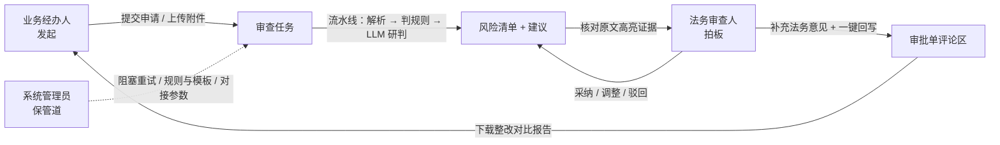

# 2.4.2 用户角色与权限设计

> 对应需求：`2.4 合同审批审查系统.md` § 2.4.2 用户角色与权限
> 实现位置（**两侧同一份矩阵**）：
> 前端 `frontend/src/permissions.js` · `frontend/src/stores/auth.js` · `frontend/src/directives/perm.js` · `frontend/src/router/index.js`
> 后端 `app/core/permissions.py` · `app/api/deps.py`（`require_perm`）· `app/core/security.py`（密码与令牌）
> 可视化页面：`/#/permissions`（登录后任意身份都可见，用来对照本文件；页内含数据库里的真实登录账号表）

---

## 一、设计结论：三个角色，一个「共同底座 + 三种差异权」

需求给了三个角色，但没有划清边界。实际做的时候最容易犯的错是
**只做菜单级隔离** —— 结果三个角色看到的界面不一样，但点进去能干的事完全一样，等于没做权限。

所以这里把权限拆成 **21 个「资源.动作」权限点**，按三层组织：

| 层 | 内容 | 谁有 |
|---|---|---|
| **共同底座（查看类）** | 看任务、看原文、看风险点与建议 | 三个角色都有 |
| **差异权（决定权）** | 采纳/调整/驳回建议、补法务意见、触发审批回写 | **只有法务审查人** |
| **差异权（发起权）** | 提交审查申请、上传合同附件 | **只有业务经办人** |
| **差异权（维护权）** | 审批流对接参数、规则与模板库、阻塞重试、批量操作、登录账号 | **只有系统管理员** |

一句话记住三个角色：**法务拍板、经办人送审、管理员修管道**。



---

## 二、角色定义

| 角色 | 演示账号（用户名 / 密码） | 数据范围 | 一句话职责 |
|---|---|---|---|
| **法务审查人** | `li.jing` / `lawyer123` 李静（法务部，法务审查专员）<br/>`wang.fang` / `lawyer123` 王芳（法务部，法务经理） | 全部合同 | 对风险点拍板：核对原文证据、采纳或调整修改建议、补充法务意见并触发回写 |
| **业务经办人** | `zhang.wei` / `operator123` 张伟（采购部）<br/>`liu.yang` / `operator123` 刘洋（销售部） | 本部门送审的合同 | 发起与跟踪：提交审查申请、查看风险点与整改建议、下载审查报告 |
| **系统管理员** | `admin` / `admin123` 系统管理员（信息中心） | 全部合同 + 系统配置 | 保管道：配置审批流对接参数、维护审查规则与标准条款库、监控任务并处理阻塞重试 |

> 账号存在数据库 `sys_user` 表（启动时幂等种入，`is_demo=true` 的才会在登录页显示为演示卡片）。
> 密码只存 **PBKDF2-HMAC-SHA256 摘要**（`pbkdf2_sha256$轮数$盐$hex`），接口任何响应都不返回摘要。
> 演示密码是刻意弱口令（`lawyer123` 这类），**上线前必须改**，并清掉演示账号。

---

## 三、需求原文 → 权限点：逐条落地

需求原文的职责描述是「能力清单」，必须逐条映射到可校验的权限点，否则验收时对不上。

### 3.1 法务审查人

| 需求原文 | 落成的权限点 | 界面表现 |
|---|---|---|
| 查看合同审查详情 | `task.view` | 大盘列表、工作台可进 |
| 核对原文高亮证据 | `doc.view` `doc.preview` | 工作台左栏文本层高亮 + 原件视图（PDF / 扫描件） |
| 采纳或调整修改建议 | `risk.view` `risk.copy` `risk.decide` | 风险卡片上的「采纳 / 调整后采纳 / 驳回」+ 示范条款编辑、一键复制 |
| 补充法务意见并触发审批回写 | `comment.add` `writeback.trigger` | 「报告与回写」页批注表单 + 一键回写 + 回写状态轮询 |
| （工作台内导出报告，见 2.4.3） | `report.view` `report.download` | 报告预览弹窗、导出 Markdown / PDF |
| （需要知道规则口径才能解释风险） | `rule.view` | 规则与模板页**只读** |

### 3.2 业务经办人

| 需求原文 | 落成的权限点 | 界面表现 |
|---|---|---|
| 提交合同审查申请 | `task.submit` `task.upload` | 侧栏「上传合同」入口、大盘右上「上传合同」按钮 |
| 查看合同风险点与整改建议 | `task.view` `doc.view` `doc.preview` `risk.view` `risk.copy` | 可进工作台，能看到全部风险卡片与建议，可复制 |
| 下载审查报告 | `report.view` `report.download` | 报告预览 + 导出 |

**注意**：经办人对风险项**没有决定权**。工作台底部会明确显示
「只读视图：当前身份（业务经办人）无「采纳 / 调整」权限，风险处理由法务审查人完成」，
而不是把按钮藏起来让人以为系统没这功能。

### 3.3 系统管理员

| 需求原文 | 落成的权限点 | 界面表现 |
|---|---|---|
| 配置审批流对接参数 | `admin.approval` | 引擎状态页的「审批系统对接配置」（失败率 / 延迟 / 超时阈值 + 待办拉取 + mock 重置） |
| 维护合规审查规则与标准条款库 | `rule.view` `rule.edit` `template.edit` | 规则与模板页：规则启停、条件编辑表单、示范条款模板库增改 |
| 监控审查任务状态并处理阻塞重试 | `task.monitor` `task.retry` `task.batch` `engine.view` | 大盘阻塞统计卡、列表行内重试、批量重试/执行/删除、工作台「跑流水线 / 重新解析 / 重新审查」、引擎状态页 |
| （为支撑上面三条，新增）维护登录账号 | `user.manage` | `/permissions` 页的「登录账号」表（账号 / 姓名 / 角色 / 职位 / 部门 / 权限数 / 职责 / 状态） |

**注意**：管理员**不做业务决定**，也没有 `risk.decide` / `writeback.trigger`；
也**不代替经办人建单**（无 `task.submit` / `task.upload`），
避免「运维顺手改了法务结论」这类越权。

### 3.4 「不同职位不同权限」的落地：登录账号体系

需求要的是**不同职位的人登录后看到不同的工作内容**，所以「角色」必须落到**真实的账号**上，
而不是前端一个可以随便切的下拉框。为此本期补了三件事（需求原文没明写，但不做就达不到验收效果）：

| 补的东西 | 位置 | 说明 |
|---|---|---|
| 账号表 | `sys_user`（`app/models/tables.py`） | 用户名唯一；密码只存 PBKDF2 摘要；带姓名 / 部门 / 职位 / 职责说明 / 启用状态 |
| 登录与令牌 | `app/api/v1/auth.py` · `app/core/security.py` | `POST /auth/login` 发令牌；`GET /auth/me` 回身份与权限点；`GET /auth/demo-accounts` 供登录页展示 |
| 服务端权限 | `app/core/permissions.py` · `app/api/deps.py` | 同一份矩阵在服务端用 `require_perm(...)` 再执行一遍 |

5 个演示账号刻意覆盖「**同角色不同职位**」（法务审查专员 vs 法务经理；采购经办人 vs 销售经办人）——
这样能顺带说明一件事：**本期权限粒度到角色，不到个人**。同一角色的两个账号权限点完全相同，
职位差异只体现在姓名 / 部门 / 职责说明上；要做「同角色内再分权」（比如法务经理能终审、
专员只能提建议），需要在 `ROLE_PERMISSIONS` 之外再加一层「职位 → 额外权限」。

---

## 四、权限矩阵（21 个权限点 × 3 角色）

✓ 持有　– 不持有

| 分组 | 权限点 | 说明 | 法务 | 经办 | 管理员 |
|---|---|---|---|:--:|:--:|:--:|
| 审查任务 | `task.view` | 查看任务列表与审查详情 | ✓ | ✓ | ✓ |
| 审查任务 | `task.submit` | 提交合同审查申请 | – | ✓ | – |
| 审查任务 | `task.upload` | 上传合同附件 | – | ✓ | – |
| 审查任务 | `task.monitor` | 监控任务状态（进度 / 阻塞原因） | – | – | ✓ |
| 审查任务 | `task.retry` | 处理阻塞重试 / 重新解析 | – | – | ✓ |
| 审查任务 | `task.batch` | 批量操作（重试 / 执行 / 删除） | – | – | ✓ |
| 文档视窗 | `doc.view` | 查看原文与高亮证据 | ✓ | ✓ | ✓ |
| 文档视窗 | `doc.preview` | 原件预览（PDF / 扫描件） | ✓ | ✓ | ✓ |
| 风险与建议 | `risk.view` | 查看风险点与整改建议 | ✓ | ✓ | ✓ |
| 风险与建议 | `risk.copy` | 复制修改建议 | ✓ | ✓ | – |
| 风险与建议 | `risk.decide` | 采纳 / 调整 / 驳回修改建议 | ✓ | – | – |
| 协同回写 | `comment.add` | 补充法务意见（批注） | ✓ | – | – |
| 协同回写 | `writeback.trigger` | 触发审批回写 | ✓ | – | – |
| 协同回写 | `report.view` | 预览审查报告 | ✓ | ✓ | – |
| 协同回写 | `report.download` | 下载审查报告（Markdown / PDF） | ✓ | ✓ | – |
| 规则配置 | `rule.view` | 查看审查规则与标准条款库 | ✓ | – | ✓ |
| 规则配置 | `rule.edit` | 维护审查规则（启停 / 条件编辑） | – | – | ✓ |
| 规则配置 | `template.edit` | 维护标准示范条款模板库 | – | – | ✓ |
| 系统配置 | `admin.approval` | 配置审批流对接参数与故障演练 | – | – | ✓ |
| 系统配置 | `engine.view` | 查看引擎状态与自检结果 | – | – | ✓ |
| 系统配置 | `user.manage` | 查看与维护登录账号（见 `/permissions` 的账号表） | – | – | ✓ |

合计：法务 11 · 经办人 9 · **管理员 13**。

---

## 五、页面 / 入口 → 权限 映射

| 路由 | 页面 | 进入所需权限 | 法务 | 经办 | 管理员 |
|---|---|---|---|:--:|:--:|:--:|
| `/login` | 登录 | **公开**（唯一免登录页） | ✓ | ✓ | ✓ |
| `/` | 审查大盘 | `task.view` | ✓ | ✓ | ✓ |
| `/upload` | 上传合同 | `task.submit` | ✗→403 | ✓ | ✗→403 |
| `/tasks/:id` | 智能审查工作台 | `task.view` | ✓ | ✓（只读） | ✓（可运维） |
| `/rules` | 规则与模板 | `rule.view` | ✓（只读） | ✗→403 | ✓（可编辑） |
| `/engine` | 引擎状态 / 对接配置 | `engine.view` | ✗→403 | ✗→403 | ✓ |
| `/permissions` | 角色与权限 | 登录即可（全员可见；账号表需 `user.manage`） | ✓ | ✓ | ✓ |

侧栏菜单同步收敛结果（运行态实测）：

- 法务审查人：`审查大盘 | 规则与模板 | 角色与权限`
- 业务经办人：`审查大盘 | 上传合同 | 角色与权限`
- 系统管理员：`审查大盘 | 规则与模板 | 引擎状态 | 角色与权限`

---

## 六、实现方式

### 6.1 前端（本期已实现）

| 文件 | 职责 |
|---|---|
| `src/permissions.js` | **前端侧矩阵**：角色、权限点、角色→权限、菜单表、角色工作台。与后端 `app/core/permissions.py` **同构**，由 `tests/test_permissions_sync.py` 钉住一致性 |
| `src/stores/auth.js` | 登录态（Pinia）：`token + user`，持久化在 `localStorage[ca.auth]`；`has / hasAny / hasAll` 判定，权限点**优先取服务端下发的那份** |
| `src/views/LoginView.vue` | 登录页：账号密码 + 演示账号一键填充 + 角色权限说明；提交后写入登录态并回跳 `redirect` |
| `src/components/UserMenu.vue` | 顶栏用户菜单：显示当前用户 / 权限数，下拉含「角色与权限 / 切换账号 / 退出登录」 |
| `src/directives/perm.js` | `v-perm="'risk.decide'"`：无权限则**禁用 + 置灰 + 鼠标提示缺哪个权限**；`v-perm.hide` 则直接移除 |
| `src/router/index.js` | 三层守卫：公开页放行 → 未登录送 `/login` → 权限不足送 `/403`（`meta.perm`） |
| `src/api/index.js` | 请求拦截器统一带 `Authorization: Bearer`；401 自动清登录态并跳登录 |
| `src/views/NoPermission.vue` | 403 页，说明「当前身份 + 缺哪个权限 + 目标地址」，出口是**退出并用有权限的账号重登** |
| `src/views/PermissionsView.vue` | 权限矩阵可视化页（本文件的线上版）+ 数据库真实登录账号表（需 `user.manage`） |

**为什么用指令而不是到处写 `v-if`**：`v-perm` 默认**禁用而非隐藏**，
用户能看到「有这个功能但我不能用」+ hover 提示缺什么权限，比凭空消失更容易理解和排查。
图标按钮这类禁用会很突兀的地方才用 `.hide`。

> ⚠️ **这里踩过一个很隐蔽的坑，改 `perm.js` 前务必知道**：`v-perm` 的入参基本都是
> **字面量**（`'rule.edit'`），所以 `binding.value` 永远等于 `binding.oldValue`。
> 最初的 `updated` 钩子写成了「先清掉禁用痕迹，再 `if (值变了) 重算`」——
> 结果**清了但永远不会再算**：表格数据回来触发一次 `updated`，禁用就被抹掉，
> 元素恢复成可用状态。表现为「法务审查人在规则页能直接点开『编辑条件』抽屉，
> 而 `title` 里还挂着『无此权限』的提示」——看着像生效了，其实没有。
> 换账号时更明显：管理员登出、改用李静（法务）登录后，按钮依然是活的。
>
> 现在的修法是两层，缺一不可：① `updated` 里**无条件重算**，不做值比较；
> ② 额外 `watch` 认证 store 的 `roleKey`，因为身份变化时元素自身的响应式依赖
> 可能根本没变（vnode 不重渲染就没有 `updated` 钩子），只能靠外部信号兜底。
> 回归用例见 6.3 的 `switches` 段。

### 6.2 后端（已实现：同一份矩阵，服务端也执行一遍）

前端收敛只负责「别让用户点到不该点的东西」，**真正的闸门在接口**。
矩阵在服务端用同一份定义再执行一次，两侧不一致会被测试直接拦下。

| 关注点 | 实现 | 关键约定 |
|---|---|---|
| 密码 | `app/core/security.py`：PBKDF2-HMAC-SHA256，随机盐，存 `pbkdf2_sha256$轮数$盐$hex` | 接口任何响应都不返回摘要（`user_to_dict` 白名单序列化） |
| 令牌 | 同文件：标准库 `hmac` 自签名的 HS256 语义，默认有效期 12 小时 | **零第三方依赖**；载荷含 `uid / username / role / exp` |
| 取令牌 | `app/api/deps.py::_extract_token` 支持三处：`Authorization: Bearer`、`X-Auth-Token`、`?token=` | `?token=` 是给 `window.open` / `` 这类**浏览器直连**用的（报告下载、原件预览） |
| 鉴权依赖 | `require_perm("rule.edit")` / `require_any_perm(...)` | ⚠️ 必须写成 `dependencies=[Depends(require_perm("rule.edit"))]`；直接写 `require_perm(...)` 会报 `'function' object has no attribute 'dependency'` |
| 403 语义 | `ForbiddenError` 响应体带 `required` 字段，点明缺哪个权限点 | 排查时先看 `required`，不用猜 |
| 操作人 | 申请人 / 送审部门 / 批注人 / 回写人**全部由登录态推导**（`AuthContext.actor`） | 前端已不再传 `by / author / role` —— 前端传的审计字段等于没有审计 |
| 账号表 | `sys_user` + `app/services/user_service.py` | 启动幂等种入 5 个演示账号；账号已存在时**不覆盖密码** |
| 开关 | `APP_AUTH_REQUIRED`（默认 `true`）· `APP_AUTH_SECRET` · `APP_AUTH_TOKEN_TTL_MINUTES` | 密钥缺省是开发值，启动打 WARNING；调试可整体关掉鉴权 |

已挂 `require_perm` 的接口：任务写操作（建单 / 上传 / 删除，**批量按动作分别校验**
`retry→task.retry`、`run→task.monitor`、`delete→task.batch`）、审批决定、批注、回写触发、
规则启停与编辑、模板维护、报告生成与下载、原件预览、引擎自检、审批对接配置、账号维护。
读接口按 `*.view` 收敛。

**仍然存在的边界（本期未做）**：

1. **令牌会出现在 URL 里**：`?token=` 是给浏览器直连场景用的，也就意味着它会进入浏览器历史与
   反代日志。生产环境应换成 HttpOnly Cookie 或一次性下载票据。
2. **没有刷新令牌与撤销列表**：改密码 / 停用账号不会让已发出的令牌立刻失效，要等它自然过期
   （默认 12 小时）。`enabled=false` 的账号在每次请求时会被拦（查库校验），这条是有效的。
3. 演示账号是弱口令且 `is_demo=true`，上线前必须清掉。

### 6.3 回归验证（可复跑，别靠肉眼）

权限这东西改错了不会报错，只会**悄悄失效**，所以必须有可复跑的断言。
本项目有一份「角色 × 页面」规格，用无头 Chrome 真切身份、真访问 URL 来验：

```bash
# 前提：后端 uvicorn 在 8000；前端 dev server 端口见 --base（5173 常被旧进程占，vite 会退到 5174）
# 取任务 id 需要令牌（接口已鉴权），所以先登录
.venv/Scripts/python.exe -c "
import urllib.request, json
B='http://127.0.0.1:8000/api/v1'
r=urllib.request.Request(B+'/auth/login', data=json.dumps({'username':'admin','password':'admin123'}).encode(), headers={'Content-Type':'application/json'})
tok=json.load(urllib.request.urlopen(r))['token']
t=json.load(urllib.request.urlopen(urllib.request.Request(B+'/tasks?limit=50', headers={'Authorization':'Bearer '+tok})))
for it in t['items']: print(it['id'], it['status'], it['title'])"

python "C:/Users/NYH/.workbuddy/skills/frontend-page-verify-cdp/scripts/verify_pages.py" \
  --spec scripts/verify_pages.spec.json --base http://localhost:5173 \
  --task-id <上一步选一个 completed 的任务 id> --out docs/screenshots
# 期望：88 条断言全通过 / 退出码 0
#      （未登录拦截 + 菜单收敛 + 403 拦截 + 页内按钮禁用 + 换账号不残留 + 截图 16 张）
```

规格里的断言项：

| 键 | 含义 |
|---|---|
| `auth` | **每个角色真登录一次**拿令牌，把登录态种进 `localStorage[ca.auth]`（验的是真实链路，不是假身份） |
| `anon` | 不种登录态，断言**未登录会被送到 `/login`**（`/`、`/rules`、`/engine`、`/upload` 四条） |
| `menus` | 侧栏菜单文本必须完全等于该列表（菜单收敛） |
| `denied` / `allowed` | 按文本定位按钮，断言**必须被 `v-perm` 禁用** / **必须没被禁** |
| `contains` | 页面正文必须出现某段文案（如经办人的「只读视图」降级提示） |
| `wait_for` | 一段返回真值的 JS，轮询到真再断言（异步表格**必须**加，否则冷启动会假 FAIL） |
| `select_rows` | 等表格出行后勾选 N 行再断言（批量操作条是 `v-if="selectedCount"`，不勾根本不在 DOM 里） |

外加顶层 `switches`：登录体系下没有「原地切身份」，等价动作是**换账号重新登录后进同一页**，
断言权限不残留 —— 这正是 6.1 那个坑的回归用例。

> 记一条排障经验：**「FAIL 但截图正常」先怀疑时序，别去改业务代码**。
> 表格数据是异步拉的，`wait_ready` 只等到 `h2`（页面壳）。冷启动那一次（vite 首次编译最慢）
> 会出「勾不到行 / 按钮状态 None / 找不到 li.jing」这类假 FAIL，而截图是断言之后拍的、数据已经在了。

### 6.4 验证查出的三个真问题（已修）

| 问题 | 表现 | 根因 | 状态 |
|---|---|---|---|
| `v-perm` 守卫被自己抹掉 | 法务审查人能点开规则页「编辑条件」抽屉 | `updated` 清了痕迹但按值比较不重算（见 6.1 的坑） | ✅ 已修 |
| 换账号后权限残留 | 管理员换成法务账号，按钮仍是可用的 | 身份变化不触发元素重渲染，缺外部信号 | ✅ 已修（watch `roleKey`） |
| **批量删除「假成功」** | 提示「批量删除：成功 N 条」，刷新后**数据一条没少** | `POST /tasks/batch` 的 `delete` 分支 `session.delete()` 后直接 `continue`，**跳过了循环尾部的 `commit`** | ✅ 已修（加 `TaskService.delete` + commit） |

前两个是**只有真开浏览器才会暴露**的：`npm run build` 绿、菜单收敛也对，
光看截图甚至会以为生效了（`title` 提示还在）。

第三个更阴：**前端回归全绿也发现不了**（按钮可用、接口 200、提示成功），
它是这一轮清理冒烟脏数据时才露出来的。修法是删除逻辑收进 `TaskService.delete` 统一入口，
并在调用处显式 `commit`；回归用例见 `tests/test_api_auth.py::test_batch_delete_really_deletes`
（断言**回查列表确认真的没了**，不只看接口返回）。

结论：验证要落到「**状态真的变了**」，接口报成功不算数；能同时覆盖前后端两条链路的断言才靠得住。

---

## 七、演示动线（四幕，能完整跑通验收第 8 条）

| 幕 | 身份 | 动作 | 观察点 |
|---|---|---|---|
| ⓪ 登录 | 访客 | 打开任意页面 → 被送到 `/login` → 点演示账号卡片（或手输）→ 登录 | 未登录进不去任何业务页；不同账号登进来看到的**菜单与工作台条不同** |
| ① 发起 | 业务经办人<br/>`zhang.wei` / `operator123` | 侧栏「上传合同」→ 拖入 `samples/` 风险版合同 → 提交 | 上传进度 → 审查进度条 → 结论摘要直接出现在同页 → 进入工作台；**申请人自动是登录人「张伟」** |
| ② 复核 | 法务审查人<br/>`li.jing` / `lawyer123` | 工作台 → 点风险卡片「定位原文」（左栏滚动高亮）→ 点左栏高亮反跳卡片 → 「调整后采纳」并改示范条款 → 「报告与回写」填批注 → 一键回写 | 双向高亮、回写状态轮询 `writing → success`、报告预览；批注人自动记为当前登录人 |
| ③ 保管道 | 系统管理员<br/>`admin` / `admin123` | 引擎状态页调失败率/延迟 → 大盘「待处理阻塞」快捷视图 → 行内「重试」或批量重新审查 → 规则页编辑条件 / 模板库新增 → `/permissions` 看账号表 | 阻塞任务重跑、规则启停即时生效、模板落库、账号表列出 5 个种子账号 |

> 换账号不用刷新页面外的东西：退出登录 → 用另一个账号登入即可（顶部用户菜单里有「切换账号」）。
> 演示时建议按 ⓪①②③ 顺序切人，能直观看到「同一个页面、同一个任务，三个角色能干的事不一样」。

---

## 八、验收对照

| 需求 2.4.2 | 状态 | 证据 |
|---|---|---|
| 法务审查人：查看详情 / 核对高亮证据 / 采纳或调整建议 / 补充意见并触发回写 | ✅ | `docs/screenshots/10_workbench_lawyer.png` |
| 业务经办人：提交申请 / 查看风险点与建议 / 下载报告 | ✅ | `docs/screenshots/08_upload_operator.png`、`11_workbench_operator.png` |
| 系统管理员：配置对接参数 / 维护规则与条款库 / 监控并处理阻塞重试 | ✅ | `docs/screenshots/09_engine_admin.png`、`07_rules_admin.png` |
| 权限差异可被**观察**（不是只写在文档里） | ✅ | 菜单收敛、403 拦截、按钮禁用 + 缺权限提示、只读提示语；**88 条断言**可复跑（见 6.3） |
| 切换账号后权限不残留 | ✅ | `docs/screenshots/13_switch_admin_to_lawyer.png`、`14_switch_lawyer_to_admin.png` |

---

## 附：截图清单（`docs/screenshots/`，全部为无头 Chrome 真实渲染）

| 文件 | 内容 |
|---|---|
| `00_login.png` | 登录页：账号密码 + 演示账号一键填充 + 角色权限说明（未登录访客被送到这里） |
| `01_dashboard_lawyer.png` | 法务视角大盘：多条件检索、批量条（已选 1 条 / 三个按钮禁用 + 「需要系统管理员权限」提示）、上传入口禁用 |
| `02_permissions_lawyer.png` | 角色与权限矩阵页（账号表按 `user.manage` 收敛为提示） |
| `03_403_lawyer_upload.png` | 403 拦截页：写明缺 `task.submit` + 目标地址 + 出口（退出并用有权限的账号重登） |
| `04_dashboard_operator.png` | 经办人视角大盘 |
| `05_dashboard_admin.png` | 管理员视角大盘：批量条三个按钮全可用 |
| `06_rules_lawyer.png` | 法务视角规则页：只能看，编辑/同步/新建模板全部置灰 |
| `07_rules_admin.png` | 管理员规则树 + 条件编辑入口（可用） |
| `08_upload_operator.png` | 经办人上传合同页（含示例合同快速体验） |
| `09_engine_admin.png` | 管理员引擎状态 + 审批流对接配置 |
| `10_workbench_lawyer.png` | 法务工作台：双栏联动 + 风险卡片 + 可编辑处理 |
| `11_workbench_operator.png` | 经办人工作台：同页只读视图（按钮禁用 + 只读提示） |
| `12_workbench_admin.png` | 管理员工作台：可运维但风险处置仍只读 |
| `13_switch_admin_to_lawyer.png` | 换账号 admin→li.jing 后回规则页：按钮即时置灰，菜单同步收敛 |
| `14_switch_lawyer_to_admin.png` | 换账号 li.jing→admin 后回规则页：按钮即时恢复可用 |
| `15_permissions_admin.png` | 管理员角色与权限页：额外显示数据库 `sys_user` 里的**真实登录账号表**（账号 / 姓名 / 角色 / 职位 / 部门 / 权限数 / 职责 / 状态） |
